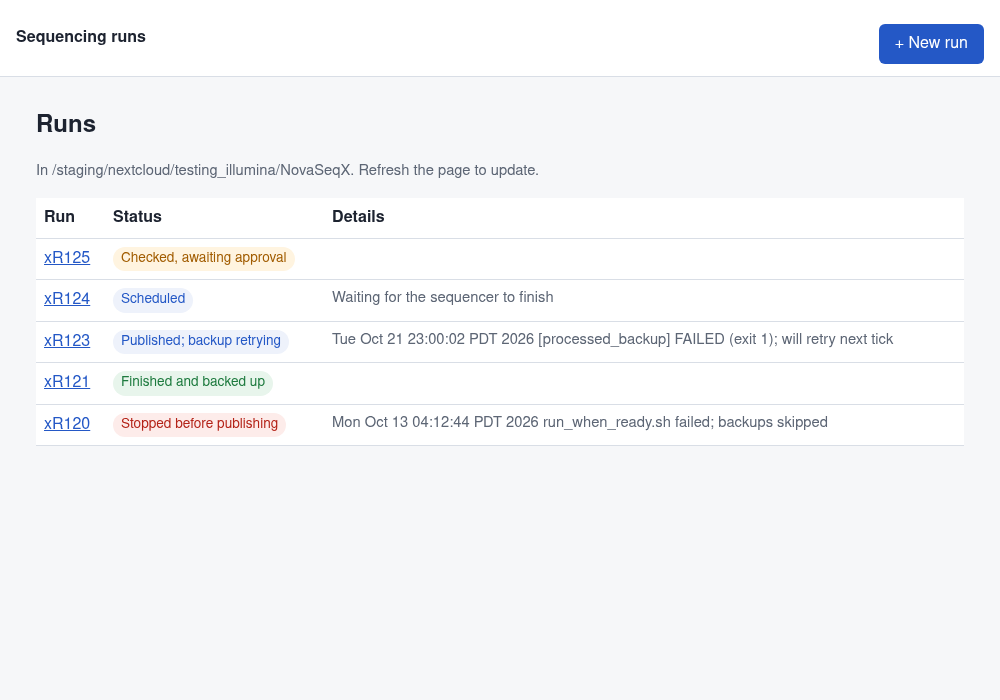
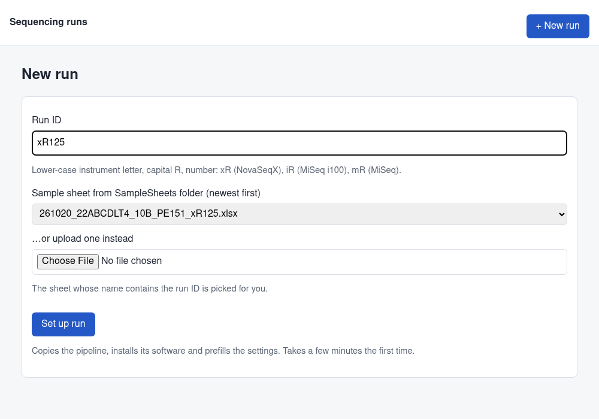
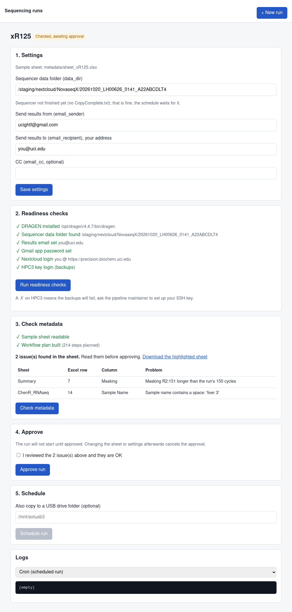
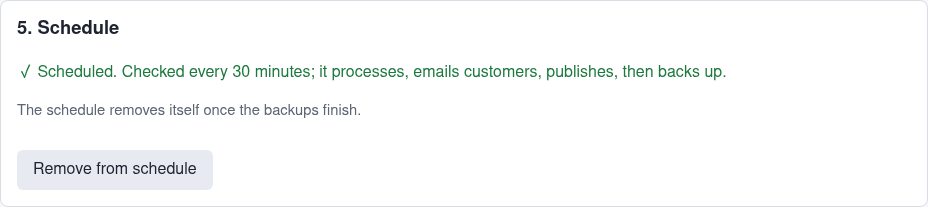

# Running a sequencing run from the web page

The page does everything the SOP does by hand: it sets up the run folder, checks the
sample sheet, waits for your approval, then schedules the run. Once scheduled, the run
starts on its own when the sequencer finishes. It processes the data, emails customers,
publishes to the share, backs up to HPC3 (and to a USB drive if you give one), then
removes itself from the schedule.



- [First-time setup](#first-time-setup-once-per-person) (once per person)
- [Open the page](#open-the-page)
- [A new run, step by step](#a-new-run-step-by-step)
- [When something needs attention](#when-something-needs-attention)
- [For the maintainer](#for-the-maintainer)

## First-time setup (once per person)

You need an account on the sequencing server (address `128.195.12.34`) and an
HPC3 account. Ask the pipeline maintainer if you have neither. Everything below is typed
into a terminal: **Terminal** on a Mac, **PowerShell** on Windows.

**1. Log in to the server.**

```bash
ssh YOUR_UCINETID@128.195.12.34
```

Every command in steps 2–5 is typed in this login window.

**2. Install pixi** (the tool that installs the pipeline's software):

```bash
curl -fsSL https://pixi.sh/install.sh | bash
```

Log out (`exit`) and log back in so the `pixi` command is found.

**3. Add your Nextcloud app password.** In Nextcloud (https://precision.biochem.uci.edu)
go to **Settings → Personal → Security → Devices & sessions**, type a name such as
`sequencing`, and press **Create new app password**. Copy the password it shows, then on
the server:

```bash
nano ~/.env
```

Type this line, with your password after the `=` sign (no spaces):

```
NEXTCLOUD_PASSWORD=paste-the-app-password-here
```

If your Nextcloud user name is different from your server login, add a second line
`NEXTCLOUD_USER=your-nextcloud-name`. Save with **Ctrl+O**, Enter, then exit with
**Ctrl+X**. Then keep the file private:

```bash
chmod 600 ~/.env
```

The Nextcloud address and the email password come from a shared file; you don't add them.

**4. Let the backups log in to HPC3 without a password.** The backups run unattended, so
they use a key instead of your password and DUO. First create a key (press Enter at every
question):

```bash
ssh-keygen -t ed25519
```

Then tell `ssh` where HPC3's transfer server is:

```bash
cat >> ~/.ssh/config <<'EOF'
Host hpc3
    HostName access-hpc3.rcic.uci.edu
    User YOUR_UCINETID
    ControlMaster auto
    ControlPath ~/.ssh/cm-%r@%h:%p
    ControlPersist 12h
    ServerAliveInterval 60
EOF
chmod 600 ~/.ssh/config
```

(Replace `YOUR_UCINETID` first.) Finally copy the key to HPC3. This asks for your HPC3
password and a DUO approval this one time:

```bash
ssh-copy-id YOUR_UCINETID@hpc3.rcic.uci.edu
```

**5. Check it all worked.** Open the page (next section), open any run, and press
**Run readiness checks**. Every line should show ✓. A ✗ on *Nextcloud login* means step 3
needs redoing; a ✗ on *HPC3 key login* means step 4.

## Open the page

1. Log in to the server and start the page. Leave this window open while you use it
   (or skip this step if you [keep it running](#keep-it-running-optional)):

   ```bash
   cd /staging/nextcloud/testing_illumina/NovaSeqX/.bcl_gui
   pixi run gui
   ```

2. It prints two things. On **your own computer**, open a second Terminal/PowerShell
   window and paste the `ssh -N -L ...` line it printed. That window stays quiet with no
   prompt; that is normal. Leave it open.
3. The first time, paste the `http://localhost:.../?token=...` link into your browser.
   After that, bookmark `http://localhost:PORT/` (your port number, without the token);
   it keeps working for 30 days, even after the page is restarted. Lost the link? Run
   `pixi run gui-link` in `.bcl_gui` on the server.

Closing the page or pressing Ctrl+C in step 1 does **not** stop scheduled runs.

**Shorter tunnel.** On your own computer, add this to `~/.ssh/config` (use your port
number and login):

```
Host bclgui
    HostName 128.195.12.34
    User YOUR_UCINETID
    LocalForward 8002 localhost:8002
```

Then step 2 is just `ssh -N bclgui`.

### Keep it running (optional)

To have the page always on, so step 1 is never needed, run this once on the server:

```bash
cd /staging/nextcloud/testing_illumina/NovaSeqX/.bcl_gui
scripts/install_gui_service.sh
```

It runs as you, survives logging out and reboots, and prints your login link. Useful
commands: `systemctl --user status bclgui`, `systemctl --user restart bclgui`,
`journalctl _SYSTEMD_USER_UNIT=bclgui.service -n 50` (its log). Remove it with
`scripts/install_gui_service.sh --uninstall`.

## A new run, step by step

**1. New run.** Press **+ New run**, type the run ID (e.g. `xR125`). The sheet named for
that run is picked for you from the lab's SampleSheets folder; if it isn't there yet,
upload it. The page refuses a sheet whose name is for a different run. Press
**Set up run** and wait until the log at the bottom says
`=== Prefill settings (pixi run init): OK ===` (a few minutes).



The run page then has five numbered boxes. Work through them top to bottom:



**1. Settings.** Check the sequencer data folder (the run's folder in
`/staging/nextcloud/NovaseqX/`) and put **your** email address in *Send results to*.
Press **Save settings**. It is fine if the sequencer hasn't finished yet.

**2. Readiness checks.** Press the button; every line should show ✓.

**3. Check metadata.** Reads the sheet and plans the work without processing anything
(takes a minute or two). Any problems with the sheet are listed, and
*Download the highlighted sheet* gives you a copy with them marked. If one is a real
mistake, get a corrected sheet from the lab, upload it as a new run, and check again.

**4. Approve.** If issues were listed, tick *I reviewed the issues* to confirm they are
OK, then press **Approve run**. Changing the sheet or the settings afterwards cancels the
approval, so the run never starts on something nobody checked.

**5. Schedule.** Optionally type a USB drive folder for an extra copy, then press
**Schedule run**. That's it:



The run list shows how it is going (refresh the page to update):

| Status | Meaning |
| --- | --- |
| Needs checking / Checked, awaiting approval | Boxes 3–4 are still to do |
| Approved, not scheduled | Box 5 is still to do |
| Scheduled | Waiting for the sequencer; checked every 30 minutes |
| Processing | The workflow is running (several hours) |
| Published; backing up | Customers have their data; backups running |
| Published; backup retrying | A backup failed; it retries every 30 minutes |
| Finished and backed up | Nothing left to do |
| Stopped before publishing / Approval withdrawn | Needs a person; see below |

## When something needs attention

- **Stopping a run**: open the run and press the red **Stop this run** (shown while it is
  processing or backing up; also **Stop** while the page's own setup or check is running).
  It removes the run from the schedule and tells it to shut down; that takes up to a
  minute. A stopped processing run becomes *Stopped before publishing* and does not
  restart by itself. If publishing had already begun, some customers may have their email.
  Stopped backups keep what finished; press **Schedule run** again to finish the rest.
  Only the operator who scheduled a run can stop it.
- **Approval withdrawn**: the sheet or settings changed after you approved. Check again
  and re-approve.
- **Stopped before publishing**: the workflow failed. Open the run, pick
  *Workflow (snakemake)* in the log list, and send the end of it to the pipeline
  maintainer. The page deliberately has no "run again" button: a re-run re-emails every
  customer.
- **Published; backup retrying**: if it keeps failing, check the *Cron* log and the HPC3
  readiness check.
- **The page won't load**: is the `pixi run gui` window still open on the server (or
  `systemctl --user status bclgui` active), and the `ssh -N -L` window on your computer?
  Restart what stopped.
- **"Not logged in"**: the 30 days ran out or the token was replaced. Run
  `pixi run gui-link` on the server and open the link.

## For the maintainer

- The control clone is `<platform>/.bcl_gui` (set up once per platform folder:
  `git clone https://github.com/uci-grthub/bcl_conversion <platform>/.bcl_gui && cd $_ && pixi install`).
  `git pull` there updates the page and the pipeline version new runs get (new run dirs
  are cloned from it). Only the owner may change its code: every operator's page and cron
  jobs run whatever is in it, as that operator, so a group-writable copy lets any group
  member act as any operator. Keep `logs/` group-writable for setup logs and uploads:
  `chmod -R go-w .bcl_gui && chmod -R g+rwX .bcl_gui/logs`. After `git pull`, operators
  running the service should `systemctl --user restart bclgui`.
- Each operator runs their own copy of the page: cron entries go into their crontab and
  use their `~/.env` and hpc3 SSH key. The port is `8000 + uid % 1000`; `--port` overrides.
- The page binds `127.0.0.1` and requires the token, since every account on the host can
  reach a local port. It also refuses any `Host` other than `localhost:PORT` /
  `127.0.0.1:PORT` (DNS rebinding). The token and cookie-signing key live in
  `~/.config/bclgui/` (mode 600); `pixi run gui --new-token` replaces the token and logs
  out every browser (restart the service after). Under systemd the token is not printed,
  so it stays out of the journal. Never bind it to another address or put it behind a
  proxy without real authentication.
- Approval is `.metadata_approved` in the run dir, holding a sha256 of the sheet + project
  config. `run_when_ready.sh` refuses to start without a matching one; a run scheduled by
  hand (no GUI) needs `REQUIRE_APPROVAL=0` on its cron line.
- **Stop** finds the process groups holding `.auto_launch.lock` / `.post_publish.lock`
  (via `/proc/*/fd`, so only the operator's own) and sends them SIGTERM after removing the
  cron line. By hand: `kill -TERM -- -PGID`, where PGID is the group of the
  `run_and_backup_when_ready.sh` process (`ps -o pgid= -p PID`). Never `kill -9`: the
  bcl_convert rule's TERM trap is what stops DRAGEN, and a killed shell leaves DRAGEN
  orphaned on the board holding its locks. To resume a stopped processing run, delete
  `.auto_launched` and schedule it again; snakemake picks up where it stopped. Check first
  whether publish had started (`logs/cron_run.log`), since publish re-sends every email.
- GUI cron entries end in `# bclgui:<run_id>`; `run_and_backup_when_ready.sh` deletes that
  line once every backup step has its `.post_<step>.done` marker.
- The screenshots in `docs/images/` come from a demo folder of fake runs, not real data.
